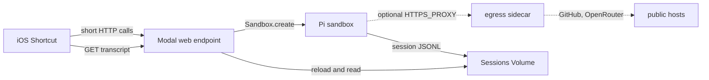

# Pi on Modal

A map of how the [Pi](https://pi.dev) coding agent in [`pi-container`](https://github.com/TanGentleman/tan-toolchains/tree/container-bootstrap-v1/pi-container) can run on [Modal](https://modal.com/llms.txt), and how an iOS Shortcut can start a run and later read it.

This is a mental model. It lists the pieces, the constraints that connect them, and the options at each seam. It is based on shallow clones of `TanGentleman/tan-toolchains`:

- [`container-bootstrap-v1` @ `7aca9f9`](https://github.com/TanGentleman/tan-toolchains/commit/7aca9f9) (23 Oct 2026, 11:05 PM EDT)
- [`zigpeek` @ `014f8fa`](https://github.com/TanGentleman/tan-toolchains/commit/014f8fa) (24 Oct 2026, 12:30 AM EDT)

Modal behavior below is from the linked docs as of 24 Oct 2026.

## Mental model

Three places, with a Volume as the transcript:



| Place | What it is | What it can do |
| --- | --- | --- |
| Phone | Shortcut, or a page that can send headers | Call the web endpoint. It cannot mount a Modal Volume. |
| Control plane | A deployed [Function](https://modal.com/docs/guide/webhooks.md), [Server](https://modal.com/docs/guide/servers.md), or ASGI app | Create sandboxes, read Secrets, read and commit Volumes. This process is the Modal app. |
| Sandbox | [Modal Sandbox](https://modal.com/docs/guide/sandboxes.md) running the Pi image | Run Pi, git, and Zig. Sandboxes are not given the app's Modal credentials. |

The OpenAI Agents SDK post ([Building with Modal and the OpenAI Agents SDK](https://modal.com/blog/building-with-modal-and-the-openai-agent-sdk)) is a different shape: an orchestrator whose tools are shell sessions in sandboxes. Pi is already a harness (read, bash, edit, write). The post is useful as a picture of sandboxes, quotas, and filesystem snapshots. It is not required as a second agent loop around Pi.

## What the two branches already contain

### `pi-container` (`container-bootstrap-v1`)

[README](https://github.com/TanGentleman/tan-toolchains/blob/container-bootstrap-v1/pi-container/README.md), [Dockerfile](https://github.com/TanGentleman/tan-toolchains/blob/container-bootstrap-v1/pi-container/Dockerfile), [`proxy.py`](https://github.com/TanGentleman/tan-toolchains/blob/container-bootstrap-v1/pi-container/proxy.py), [`run.sh`](https://github.com/TanGentleman/tan-toolchains/blob/container-bootstrap-v1/pi-container/run.sh).

Today this is an Apple `container` VM, not a Modal app. The split is:

- **Pi container.** Image has Pi `1.4.0`, git, `gh`, ripgrep, fd, Zig `0.17.0`, and a frozen `zigpeek`. It sits on an internal network, `pi-locked` (`172.30.240.0/24`). Its OpenRouter env var is the placeholder `sk-or-v1-placeholder`. `HTTP_PROXY` / `HTTPS_PROXY` point at the proxy. `gh` holds the GitHub token and rewrites SSH remotes to HTTPS.
- **`pi-proxy`.** A second container on both the default network and `pi-locked`. It is the only process with the real OpenRouter key. It tunnels a fixed set of GitHub hosts, MITMs `openrouter.ai` to replace `Authorization`, and refuses everything else.
- **Host env file.** Stays on the Mac, mode 600. `run.sh` splits it into `proxy.env` (OpenRouter) and `pi.env` (GitHub token and git identity).

GitHub hosts in `proxy.py`: `github.com`, `api.github.com`, `codeload.github.com`, `uploads.github.com`, `objects.githubusercontent.com`, `raw.githubusercontent.com`. OpenRouter is `openrouter.ai` and its subdomains.

The image's zigpeek is PyPI `zigpeek==0.5.1`, packed with PyInstaller (a WASM autodoc). The `zigpeek` branch of the same repo is a different program: a Zig binary that parses the compiler's own `lib/` and does not download docs ([`zigpeek/README.md`](https://github.com/TanGentleman/tan-toolchains/blob/zigpeek/zigpeek/README.md)). An image can carry either. They are not the same tool.

### Pi's own interfaces

[CLI integration](https://pi.dev/docs/latest/cli-integration) describes four modes. All of them use the same agent.

| Mode | Lifetime | Output |
| --- | --- | --- |
| Interactive | Until quit | Terminal UI |
| Print | One prompt | Final text on stdout |
| JSON | One prompt | JSONL events on stdout. [Event sequence](https://github.com/earendil-works/pi/blob/main/packages/coding-agent/docs/json.md). |
| RPC | Long-lived process | JSONL commands on stdin, responses and events on stdout. [RPC](https://github.com/earendil-works/pi/blob/main/packages/coding-agent/docs/rpc.md). |

Sessions are on unless `--no-session` is set ([Sessions](https://pi.dev/docs/latest/sessions)). Files are append-only JSONL:

```text
~/.pi/agent/sessions/--<cwd-with-slashes-replaced>--/<timestamp>_<session-id>.jsonl
```

Format: [Session file format](https://pi.dev/docs/latest/session-format). Entries form a tree (`id` / `parentId`). The active leaf is the conversation a resume follows.

In the current agent, a session line is written on `message_end` (a finished user message, assistant message, or tool result), not on `message_update` token deltas. Deltas exist on the JSON stdout stream. The session file is the transcript of finished entries. See `message_end` handling in [`agent-session.ts`](https://github.com/earendil-works/pi/blob/main/packages/coding-agent/src/core/agent-session.ts) and the flush rules in [`session-manager.ts`](https://github.com/earendil-works/pi/blob/main/packages/coding-agent/src/core/session-manager.ts). The container pins Pi `1.4.0`; that tag is the version to check if the flush rule matters.

`run.sh` sets `PI_CODING_AGENT_DIR=/root/.pi/agent` and mounts a volume at `/root/.pi/agent` plus a host `settings.json` (default provider `openrouter`, model `deepseek/deepseek-v4.1-flash-1017`).

## Control plane

A deployed Modal app is the thing the phone talks to. Creating a sandbox from the phone with `MODAL_TOKEN_ID` / `MODAL_TOKEN_SECRET` would give the phone a workspace credential. A web endpoint does not.

Relevant primitives:

- [Web functions](https://modal.com/docs/guide/webhooks.md) and [web endpoints](https://modal.com/docs/guide/webhook-urls.md). Web functions are public unless `requires_proxy_auth=True`.
- [Servers](https://modal.com/docs/guide/servers.md). Servers require authentication unless `unauthenticated=True`. A Server with no containers returns 503 until one is up; requests do not queue the way Function inputs do.
- [Proxy Tokens](https://modal.com/docs/guide/webhook-proxy-auth.md). A Token ID and Token Secret (`Modal-Key` and `Modal-Secret`, or `Authorization: Bearer <id>.<secret>`). These pass Modal's edge. They are not API tokens: they do not create sandboxes, read Secrets, or deploy.
- [Secrets](https://modal.com/docs/guide/secrets.md) and [service users](https://modal.com/docs/guide/service-users.md). Service users are for automation that needs the API. Team and Enterprise.
- [Environments](https://modal.com/docs/guide/environments.md) can block unauthenticated URLs, so a deploy fails unless proxy auth is required.
- [Budgets](https://modal.com/docs/guide/budgets.md) cap workspace usage. Environment budgets are Team and Enterprise.
- [Restricted Functions](https://modal.com/docs/guide/restricted-access.md) are a different isolation tool (a function that cannot touch Modal resources). A Sandbox is the process-shaped version of that idea.

A Shortcut can set headers. Mobile Safari, loading a URL, does not. A browser page that relies on proxy auth needs some other client to attach the headers, or the endpoint is unauthenticated at Modal's edge and the app does its own login.

The spawn handler is the policy. Fields it can accept from the phone include repo, prompt, model, and a session id the app issued. Image, secrets, timeout, CPU, and network policy can be fixed in the handler regardless of what the body contains.

`Sandbox.create` returns while the sandbox keeps running, up to its own timeout. The HTTP handler does not have to stay open for the run. See [Sandboxes](https://modal.com/docs/guide/sandboxes.md) and [timeouts](https://modal.com/docs/guide/timeouts.md).

## Sandbox

[Sandboxes](https://modal.com/docs/guide/sandboxes.md) are the computer. Default properties that matter here:

- No inbound connections unless you add [tunnels or connect tokens](https://modal.com/docs/guide/sandbox-networking.md).
- No Modal credentials, so code in the sandbox cannot list Volumes, Secrets, or other sandboxes.
- Isolation is gVisor or a VM ([security model](https://modal.com/docs/guide/sandbox-networking.md#security-model)). GPU sandboxes are gVisor only and can be preempted ([resources](https://modal.com/docs/guide/sandbox-resources.md)).
- `timeout` can be set up to 24 hours. Longer work is a snapshot plus a new sandbox.
- `idle_timeout` stops a sandbox after a quiet period. Activity includes open tunnel connections.
- CPU and memory can be a request, or a `(request, limit)` pair so a burst has a ceiling ([resources](https://modal.com/docs/guide/sandbox-resources.md)).
- Commands inside a running sandbox: [`sandbox.exec`](https://modal.com/docs/guide/sandbox-spawn.md).
- Images: [defining images](https://modal.com/docs/guide/images.md), [Dockerfiles and registry images](https://modal.com/docs/guide/existing-images.md). `Image.from_dockerfile` can build `pi-container/Dockerfile`.
- Filesystem snapshots: [Snapshots](https://modal.com/docs/guide/sandbox-snapshots.md). The Agents SDK post uses these so later sandboxes skip a repeated setup.

`run.sh` today asks Apple container for 4 CPUs and 4G. Modal's `cpu` value is physical cores (1 core = 2 vCPUs). The numbers are not the same unit.

## Egress

`proxy.py` does two jobs:

1. Allow only GitHub and OpenRouter.
2. Keep the OpenRouter key out of Pi by adding it on the way out.

Modal has several controls. They do not all compose. The combinations below are from [Networking and security](https://modal.com/docs/guide/sandbox-networking.md), [Secret injection](https://modal.com/docs/guide/sandbox-secret-injection.md), and [Sidecars](https://modal.com/docs/guide/sandbox-sidecars.md).

| Approach | What it allows | Key injection | Documented constraints |
| --- | --- | --- | --- |
| `block_network=True` | No outbound traffic | No | Cannot be combined with either allowlist or with inbound CIDR. |
| `outbound_cidr_allowlist` | Any protocol to those IP ranges | No | GitHub publishes broad, changing ranges. DNS stays open unless the network is fully blocked. |
| `outbound_domain_allowlist` | TLS on port 443, matched on SNI | No | Non-TLS is blocked unless a CIDR list also matches. `*.example.com` matches the parent and subdomains. `*.github.com` does not match `objects.githubusercontent.com`. |
| Both allowlists | A flow that matches either list | No | Additive. |
| [Outbound Policy](https://modal.com/docs/guide/sandbox-secret-injection.md) | All public egress. Matching HTTPS gets headers injected outside the sandbox. | Yes, for the domains in the policy. The secret is not an env var. | Cannot be combined with `block_network`, either allowlist, `proxy_traffic_via_sidecar`, or memory snapshots (`enable_snapshot`). HTTP/1.1 only. Named Secrets only, not `Secret.from_dict`. Example: [sandbox secret injection](https://modal.com/docs/examples/sandbox_secret_injection.md). |
| Sidecar + `HTTPS_PROXY` | Pi sends proxy-aware traffic to the sidecar hostname. The sidecar dials out. | Yes, if the sidecar is `proxy.py` | Containers in one sandbox reach each other by name (`main`, or the sidecar's name) even when allowlists are set. The sidecar has its own allowlists, set at creation, not updated later. |
| `proxy_traffic_via_sidecar` | All of the main container's TCP port 443 is forced through a named sidecar. | Yes, if that sidecar terminates TLS | The sidecar receives a raw TLS ClientHello and reads SNI. `SO_ORIGINAL_DST` is not available. `proxy.py` speaks HTTP CONNECT, so it does not drop in unchanged. Cannot be combined with `block_network`, a domain allowlist on the sandbox, a Modal Proxy, or an Outbound Policy. A sandbox CIDR list is allowed and does not apply to the relayed 443 traffic. Until the sidecar is running, that 443 traffic is refused. |

Other notes from those pages:

- Domain allowlists do not decrypt TLS. They do not see `Host`, path, or body. Two names on one TLS endpoint can be reached by sending an allowlisted SNI with a different `Host` (domain fronting). A sidecar that inspects HTTP is the documented alternative when that matters.
- Encrypted Client Hello hides the real name. The allowlist and the Outbound Policy see the outer name.
- DNS is allowed under an allowlist. `block_network` is what drops it. On a sidecar, an empty `outbound_cidr_allowlist` blocks public resolvers such as `8.8.8.8`; Modal's resolver still answers.
- Sidecars have no `block_network`. An empty CIDR list is the documented stand-in, and it still leaves the bridge to `main`.
- An Outbound Policy installs a CA at `/etc/modal/sandbox-egress-ca.crt` and sets `SSL_CERT_FILE`, `REQUESTS_CA_BUNDLE`, `CURL_CA_BUNDLE`, and `NODE_EXTRA_CA_CERTS`. `proxy.py` does the same job with its own CA mounted at `/etc/pi-proxy-ca`.
- The GitHub token stays inside Pi either way. The proxy tunnels GitHub without decrypting it, and `gh` reads `GITHUB_TOKEN` to feed git. A domain allowlist limits which TLS names that process can open. It does not remove the token from the environment.

`run.sh` already depends on clients honoring `HTTPS_PROXY` (Pi, git, curl, Node). That is the explicit-proxy sidecar path. The transparent path is `proxy_traffic_via_sidecar`, which wants an SNI-aware proxy rather than CONNECT.

## Reading output and past chats

The phone has three ways to see a run. They can be combined. A Shortcut is a better fit for short requests than for one HTTP body held open for the whole run.

### Stream the spawn call

JSON mode writes events to stdout, including `message_update` deltas, then `message_end`, then `agent_settled` ([JSON docs](https://github.com/earendil-works/pi/blob/main/packages/coding-agent/docs/json.md)). The web endpoint can read `sandbox.exec` streams or the sandbox's stdout and forward them.

RPC mode keeps a stdin open for later prompts, aborts, and model changes. Something has to hold that pipe. A server inside the sandbox can do it, but that server is on the agent's localhost, so it is not a boundary between the agent and the UI.

### Persist on a Volume, and fetch

[Volumes](https://modal.com/docs/guide/volumes.md) are the durable disk.

- A mount sees the Volume as it was at container start.
- Writes become visible to other containers after a commit. Background commits run every few seconds during a Function or Sandbox, and again on shutdown. `Volume.commit()` commits on demand from a process that has the Modal SDK.
- A reader calls `Volume.reload()` to see commits made after it started. During that reload the Volume looks empty in the container that called it. Reload fails with "volume busy" if that container still has files on the Volume open.
- Read-only mount: `volume.with_mount_options(read_only=True)`.
- Two containers writing the same file: last commit wins. There is no distributed lock.
- v1 has a 500,000 inode cap. v2 (`modal volume create --version=2`, or `version=2` on `from_name`) lifts that, allows `sync /mountpoint` from inside a sandbox, and is documented as beta: Modal does not yet guarantee that no data will be lost.
- Sandboxes do not have Modal API credentials, so `Volume.commit()` inside the sandbox is not the usual path. Background commits still run. `sync` on the mount is the v2 way to commit from a sandbox shell.

Pi's session directory can be that mount. With sessions left on, finished `message_end` entries are the transcript. Token deltas are not in the file. A poll sees new entries after the next commit and the next reload.

The Shortcut still calls the web endpoint. The endpoint mounts the Volume read-only, reloads, and returns a projection (for example role and text on the active leaf, skipping the system prompt and tool schemas). A client-supplied filesystem path is an escape; a session id the app issued can be joined on the server.

A small run record is a separate file from the JSONL, written once by the control plane (`run id`, `session id`, `sandbox id`, repo). The sandbox does not need to rewrite it. `running` can be answered with the sandbox id ([`Sandbox.from_id`](https://modal.com/docs/guide/sandboxes.md)) rather than by parsing the transcript. That covers the window before the first session line is committed.

Past chats are a listing of those JSONL files. Continuing one is `pi --session <id>` ([sessions](https://pi.dev/docs/latest/sessions)). Repo checkouts can be a different Volume so transcript reloads are not sharing files with `git`.

### Connect into the sandbox

[Connect tokens](https://modal.com/docs/guide/sandbox-networking.md#connecting-to-sandboxes-with-http-and-websockets) and [encrypted tunnels](https://modal.com/docs/guide/sandbox-networking.md#forwarding-ports) expose a port. `inbound_cidr_allowlist` limits who can open a tunnel or present a connect token. It is not applied to `unencrypted_ports`. A phone on a cellular network changes address, so a fixed CIDR is a loose fit for "only my phone."

Connect-token metadata comes back as `X-Verified-User-Data`. A sidecar in the same sandbox can connect to the main container without a token and can set that header ([Sidecars → Connect Tokens](https://modal.com/docs/guide/sandbox-sidecars.md)). A server that trusts the header, in a sandbox that also has a sidecar, has that caveat.

## One assembly

The pieces above can sit together like this. It is one arrangement, not a requirement:

1. Shortcut sends `Modal-Key` / `Modal-Secret` and a second secret the handler checks. `POST /runs` takes repo, prompt, and a model from a list the handler already knows.
2. The handler writes `runs/<id>.json` to a v1 sessions Volume, commits, creates a sandbox, and returns the ids. It does not wait for Pi.
3. The sandbox image is the Pi image. Sessions are on. The session dir is the Volume. Stdout is unused. A sidecar runs `proxy.py` with the OpenRouter secret. Pi's `HTTPS_PROXY` is `http://<sidecar-name>:<port>`. The sandbox's `outbound_cidr_allowlist` is empty, so a client that ignores the proxy has no direct egress. The sidecar's `outbound_domain_allowlist` names the GitHub and OpenRouter hosts `proxy.py` already allows.
4. `GET /runs/<id>?after=<entry-id>` reloads the Volume and returns new finished entries, plus whether the sandbox is still up.
5. A second Shortcut lists session files and can `POST` a follow-up with that session id.
6. `sandbox.terminate()` is a separate call. `timeout` and `idle_timeout` bound a run the phone never comes back for.

## Reference

### This repo's inputs

- [pi-container on `container-bootstrap-v1`](https://github.com/TanGentleman/tan-toolchains/tree/container-bootstrap-v1/pi-container)
- [zigpeek on `zigpeek`](https://github.com/TanGentleman/tan-toolchains/tree/zigpeek/zigpeek)
- [Pi](https://pi.dev)
- [@earendil-works/pi-coding-agent](https://www.npmjs.com/package/@earendil-works/pi-coding-agent)

### Modal index and the Agents SDK post

- [llms.txt](https://modal.com/llms.txt)
- [Building with Modal and the OpenAI Agents SDK](https://modal.com/blog/building-with-modal-and-the-openai-agent-sdk)

### Sandboxes

- [Sandboxes](https://modal.com/docs/guide/sandboxes.md)
- [Running commands](https://modal.com/docs/guide/sandbox-spawn.md)
- [Networking and security](https://modal.com/docs/guide/sandbox-networking.md)
- [Files](https://modal.com/docs/guide/sandbox-files.md)
- [Snapshots](https://modal.com/docs/guide/sandbox-snapshots.md)
- [Resources and pricing](https://modal.com/docs/guide/sandbox-resources.md)
- [Sidecars](https://modal.com/docs/guide/sandbox-sidecars.md)
- [Secret injection](https://modal.com/docs/guide/sandbox-secret-injection.md)
- [Secret injection example](https://modal.com/docs/examples/sandbox_secret_injection.md)
- [Timeouts](https://modal.com/docs/guide/timeouts.md)

### Calling it from a phone

- [Web functions](https://modal.com/docs/guide/webhooks.md)
- [Web endpoint URLs](https://modal.com/docs/guide/webhook-urls.md)
- [Proxy Tokens](https://modal.com/docs/guide/webhook-proxy-auth.md)
- [Servers](https://modal.com/docs/guide/servers.md)
- [Secrets](https://modal.com/docs/guide/secrets.md)
- [Service users](https://modal.com/docs/guide/service-users.md)
- [Environments](https://modal.com/docs/guide/environments.md)
- [Budgets](https://modal.com/docs/guide/budgets.md)
- [Restricted Functions](https://modal.com/docs/guide/restricted-access.md)

### Disk and images

- [Volumes](https://modal.com/docs/guide/volumes.md)
- [Images](https://modal.com/docs/guide/images.md)
- [Existing Dockerfiles and registries](https://modal.com/docs/guide/existing-images.md)

### Pi sessions and modes

- [CLI integration](https://pi.dev/docs/latest/cli-integration)
- [Sessions](https://pi.dev/docs/latest/sessions)
- [Session file format](https://pi.dev/docs/latest/session-format)
- [JSON event stream](https://github.com/earendil-works/pi/blob/main/packages/coding-agent/docs/json.md)
- [RPC mode](https://github.com/earendil-works/pi/blob/main/packages/coding-agent/docs/rpc.md)
